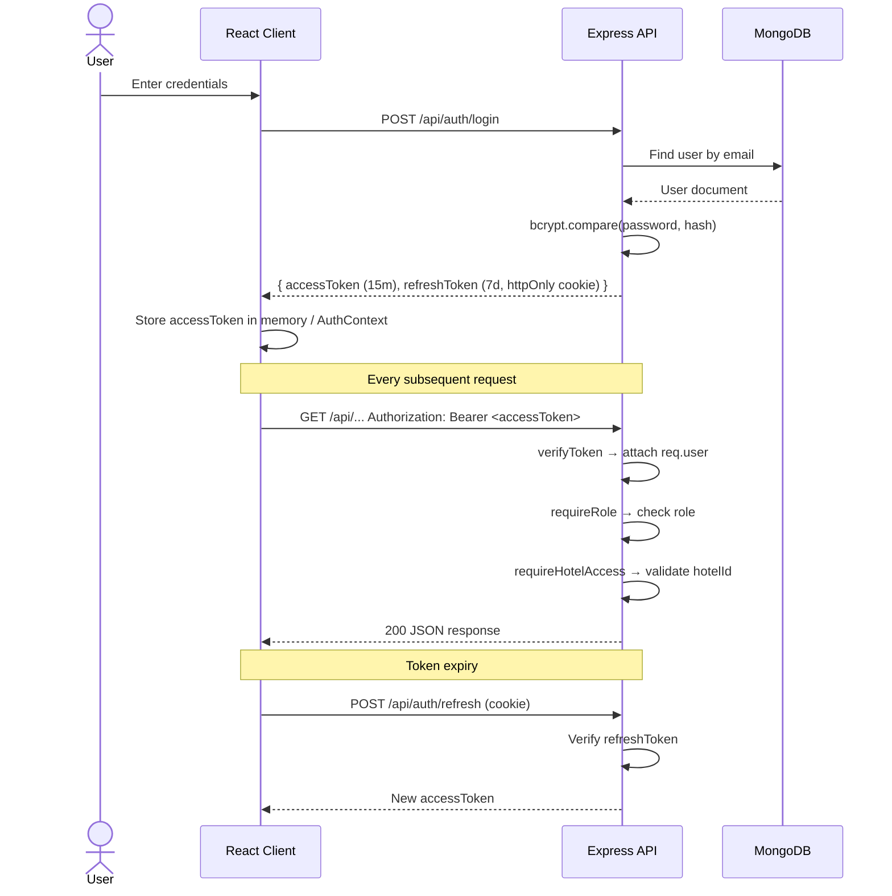
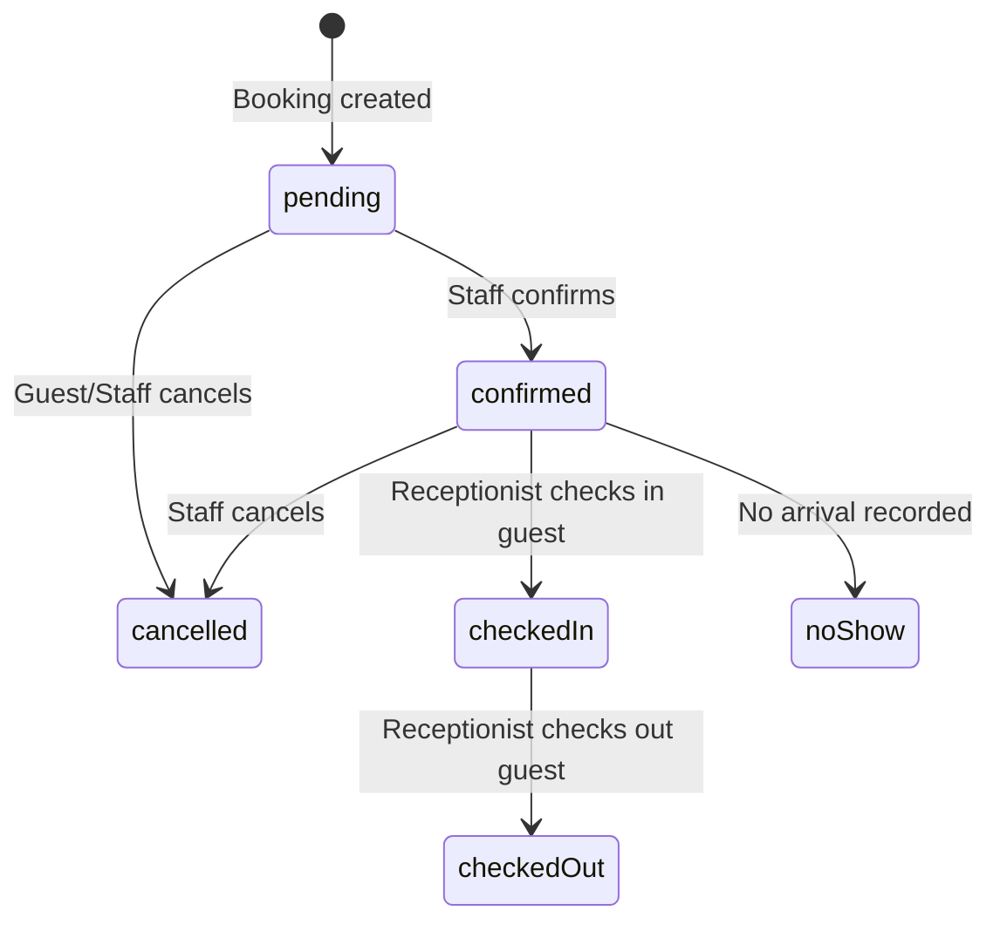
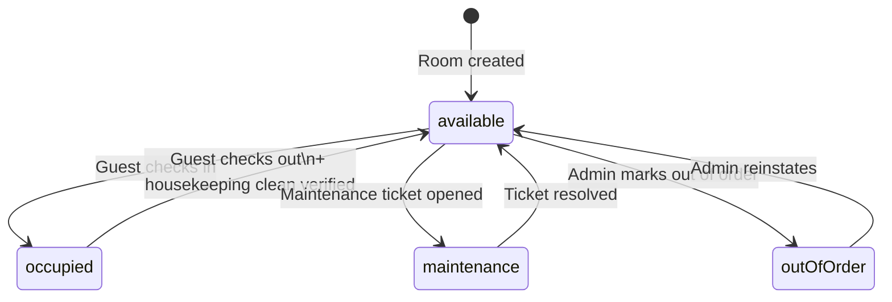
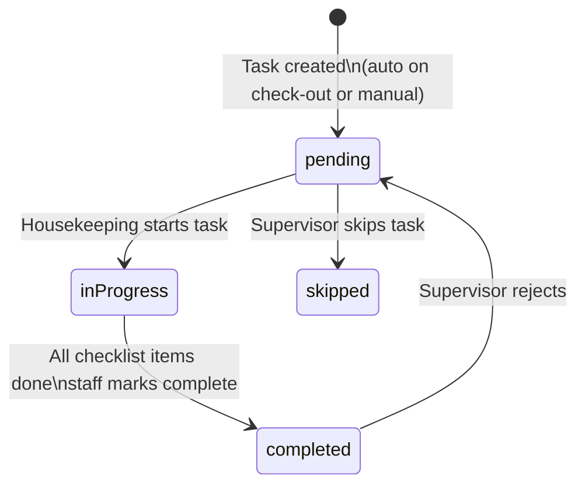
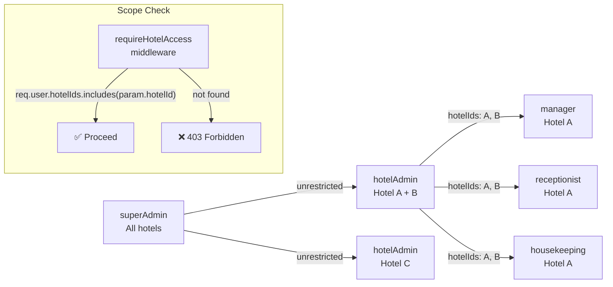
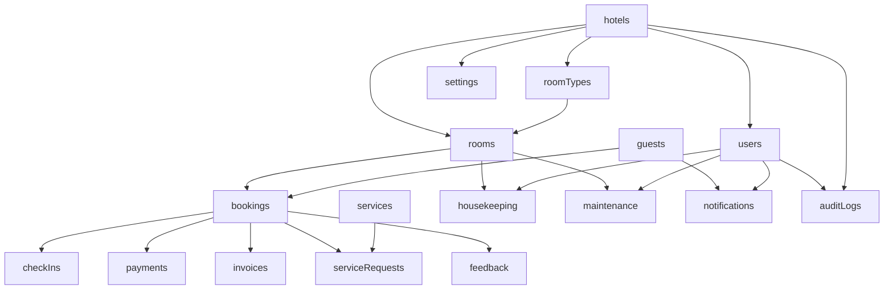

# Architecture Diagram – LuxuryStay Hospitality HMS

> **Document Version:** 1.0  
> **Date:** 2026-11-25

---

## 1. Full System Architecture

```mermaid
flowchart TD
    subgraph PUBLIC["Public Access (No Auth)"]
        PUB["Public Booking Interface\n/ Hotel Search / Room Browse"]
    end

    subgraph GUEST_P["Guest Portal  /guest/*"]
        G["Guest\nAuthenticated"]
    end

    subgraph STAFF_P["Staff Portals"]
        REC["Receptionist\n/reception/*"]
        HK["Housekeeping\n/housekeeping/*"]
        MGR["Manager\n/manager/*"]
        HA["Hotel Admin\n/hotel-admin/*"]
        SA["Super Admin\n/super-admin/*"]
    end

    subgraph CLIENT["client/  —  React SPA  Vite + Bootstrap 5"]
        AC["AuthContext\n+ useAuth hook"]
        HC["HotelContext"]
        SVC["Axios Service Layer\nauthService · bookingService · roomService\npaymentService · housekeepingService · ..."]
        RR["React Router v6\nPrivateRoute · RoleRoute"]
    end

    PUB --> CLIENT
    GUEST_P --> CLIENT
    STAFF_P --> CLIENT
    CLIENT --> RR
    RR --> AC
    AC --> HC
    HC --> SVC

    subgraph API["REST API  JSON over HTTPS"]
        EP["/api/v1/..."]
    end

    SVC -->|"Axios HTTP\nBearer JWT"| EP

    subgraph SERVER["server/  —  Node.js  +  Express.js"]
        direction TB
        MW["Global Middleware\nCORS · Helmet · Morgan\nRateLimiter · BodyParser"]
        AUTH_MW["verifyToken\nJWT validation → req.user"]
        ROLE_MW["requireRole\nrole check"]
        HOTEL_MW["requireHotelAccess\nhotelId scope check"]
        VAL["Input Validators\nexpress-validator"]
        CTRL["Controllers\nthin request/response layer"]
        SRVC["Service Layer\nbusiness logic · overlap checks\nstate machine transitions"]
        AUDIT["auditLogger middleware\nwrites auditLogs on every write"]
    end

    EP --> MW
    MW --> AUTH_MW
    AUTH_MW --> ROLE_MW
    ROLE_MW --> HOTEL_MW
    HOTEL_MW --> VAL
    VAL --> CTRL
    CTRL --> SRVC
    SRVC --> AUDIT

    subgraph MODULES["Backend Modules  server/modules/"]
        direction LR
        M_AUTH["auth"]
        M_USERS["users"]
        M_HOTELS["hotels"]
        M_GUESTS["guests"]
        M_RT["roomTypes"]
        M_ROOMS["rooms"]
        M_BOOK["bookings"]
        M_CI["checkIns"]
        M_PAY["payments"]
        M_INV["invoices"]
        M_SVC["services"]
        M_SR["serviceRequests"]
        M_HK["housekeeping"]
        M_MAINT["maintenance"]
        M_FB["feedback"]
        M_NOTIF["notifications"]
        M_SET["settings"]
        M_AUDIT["auditLogs"]
    end

    SRVC --> MODULES

    subgraph DB["MongoDB Atlas  — 17 Collections"]
        direction LR
        C_USERS[("users")]
        C_HOTELS[("hotels")]
        C_GUESTS[("guests")]
        C_RT[("roomTypes")]
        C_ROOMS[("rooms")]
        C_BOOK[("bookings")]
        C_CI[("checkIns")]
        C_PAY[("payments")]
        C_INV[("invoices")]
        C_SVC[("services")]
        C_SR[("serviceRequests")]
        C_HK[("housekeeping")]
        C_MAINT[("maintenance")]
        C_FB[("feedback")]
        C_NOTIF[("notifications")]
        C_SET[("settings")]
        C_AL[("auditLogs")]
    end

    MODULES -->|"Mongoose ODM"| DB
```

---

## 2. Authentication Flow

---

## 3. Booking Lifecycle

---

## 4. Room Status Lifecycle

---

## 5. Housekeeping Task Lifecycle

---

## 6. Multi-Hotel Scoping Model

---

## 7. Inter-Module Dependency Map

